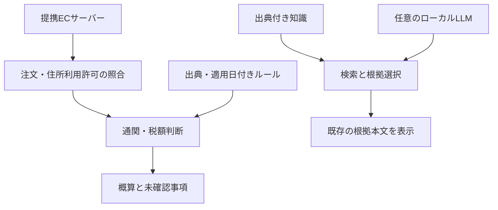

# 構成と責任境界

LLMには計算や実行の道具を渡しません。根拠選択と税額計算は別の経路です。通信に自由入力の質問、住所、注文識別子を含めません。根拠データはアプリケーションの管理対象で、外部サイトをリアルタイムにスクレイピングして自動承認する機能はありません。

| モジュール              | 役割                                      |
| ----------------------- | ----------------------------------------- |
| `schema.ts`             | API入力のJSON SchemaとAjvによる厳格な検証 |
| `data-schema.ts`        | 出典・国・知識・ルールの構造と参照整合性  |
| `dataset.ts`            | データの読み込み・ハッシュ検証・期限判定  |
| `engine.ts`             | 通関経路、対象条件、概算、未確認事項      |
| `money.ts`              | BigIntによる金額・率・通貨桁・為替の計算  |
| `assistant.ts`          | 多言語検索、根拠表示、商品属性の確認支援  |
| `ollama.ts`             | 根拠IDだけを受け取る任意のモデル接続      |
| `veygrit.ts`            | 注文・住所版・利用許可の照合ポート        |
| `http.ts` / `server.ts` | 認証付きHTTP APIとNodeサーバー            |

## 国・区域・原産地

国コードは住所や経路の索引です。関税領域、VAT区域、発送地、原産地、販売者の国は同一視しません。`originZone` と `destinationZone` は住所保管側などの信頼できる処理が判定します。特別地域や不明を通常領域へ置き換えません。

香港・マカオは中国本土のCBEC区分を継承しません。英国本土と北アイルランド、スペイン本土とカナリア諸島等は区域確認が必要です。EU内でも保税・非自由流通・特別VAT領域の貨物へ通常域内取扱いを適用しません。GCC・SACU・RCEP等の加盟だけで関税ゼロにする処理もありません。

## 計算契約

少額基準の基礎をルールごとに区別します。全明細の価格、数量、送料、保険、税抜であること、合算対象が確認済みであることを入力の契約とします。価格に含まれる送料を別途二重加算してはいけません。

GBP・EUR・SGD等の対象通貨と入力通貨が異なる場合は計算を止めます。`convertMoney` は信頼できる呼び出し側が取得した為替の分数・対象期間・目的を扱う補助関数です。為替の正当性を認定したり、レートを取得したりする機能ではありません。通関用為替と購入時の決済用為替は区別します。

小数金額を整数の最小通貨単位に変換し、率はbasis pointsで計算します。概算は貨物単位の四捨五入です。税関の明細別・段階別・切捨て等の正式な丸め規則をすべて実装したものではなく、確定請求には使いません。

概算の有効期限は最長15分です。ルールの法的な適用境界・再確認期限に先に達する場合は短縮します。現在日と輸入日の両方を再確認期限と照合するため、過去の輸入日を送って期限切れルールを再利用することはできません。

入力ハッシュは注文・商品・原産地・住所版等の変更検出に使えます。署名や本人確認の証明ではありません。DBへ概算を保存する場合は、注文版・ルール版・出典・期限・照合時点を一緒に保存し、入力に変更があれば再見積します。

## 未実装の実行領域

輸出入申告、税金納付、ラベル発行、配送予約、実名確認、制裁対象者の照合、決済はこのサービスの機能にしていません。第2段階では提携ECと通関・配送担当が実行し、第3段階の配送・VeyPOSとはAPIの責任を分けます。追加の配送仲介API契約を必須にしていません。

全世界・全品目へ税額計算を拡張するには、関税細分、原産地規則、税・追加税、許認可、地方税、特殊制度を公式資料または適法に利用できるデータから追加する必要があります。誤った全世界共通の税率や少額免税額を初期値にしない構成です。
